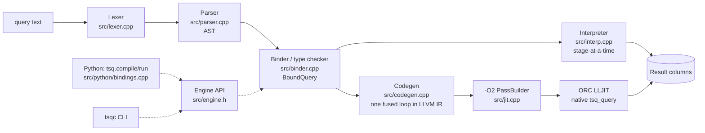

# tsq: a mini-DSL for time-series queries, JIT-compiled with LLVM

`tsq` is a small pipeline query language over columnar time-series data:

```
trades | filter price > 100 and sym == "AAPL" | window 5m mean(price) | asof_join quotes on sym
```

A query goes through a hand-written lexer and recursive-descent parser, then a
type checker that reports errors at source locations. After that it runs on
one of two back ends:

* **Interpreter.** A tree-walking reference implementation.
* **JIT.** The query is lowered to LLVM IR as **one fused loop**: filters,
  projections, incremental rolling windows and a merge-based as-of join all
  run in a single pass. The IR goes through the standard `-O2` pipeline and is
  JIT-compiled with ORC LLJIT.

It can be called from C++, from a CLI (`tsqc`) and from Python through
pybind11 (`tsq.compile(query).run(numpy_columns)`).

```python
import tsq
data = tsq.datagen.make_dataset(1_000_000)                 # synthetic trades + quotes
q = tsq.compile('trades | filter price > 100 and sym == "AAPL" | window 5m mean(price) | asof_join quotes on sym')
out = q.run(data.tables, symbols=data.symbols)             # dict[str, np.ndarray]
tsq.to_pandas(out, data.symbols).head()
```

```
$ build/tsqc 'trades | filter prise > 100'
error: unknown column 'prise' (did you mean 'price'?); available columns: ts, sym, price, size
  --> 1:17
    |
  1 | trades | filter prise > 100
    |                 ^^^^^
```

## Architecture



The JIT emits a single function, `int64_t tsq_query(QueryCtx*)`:

```
for i in 0..n:                                 # one pass over the source table
    load needed columns lazily                 # columns used only after a filter load only for passing rows
    filter   -> if !pred: continue
    project  -> pure SSA values (dead ones removed by DCE)
    window   -> evict rows with ts <= t-dur (running sums), monotonic deques for min/max
    asof     -> advance right cursor while rts <= t; last[sym] = rp; gather payload
    store surviving row to outputs[o++]
```

See [RESULTS.md](RESULTS.md) for every measurement with commands and raw output.

## Language

### Data model
* A table is a set of equal-length columns. The column types are `i64`, `f64`
  and `sym`. A `sym` is an `int32` code into a symbol dictionary shared by
  every table in a run.
* `window` and `asof_join` need an `i64` column named `ts`. It holds
  nanosecond timestamps in ascending order. `run()` checks this unless you
  pass `validate=False`.

### Grammar (EBNF)

```ebnf
query      = IDENT { "|" stage } EOF ;
stage      = "filter" expr
           | "select" item { "," item }
           | "derive" IDENT "=" expr { "," IDENT "=" expr }
           | "window" DURATION agg { "," agg }
           | "asof_join" IDENT "on" IDENT ;
item       = IDENT [ "=" expr ] ;                 (* bare column or name = expr *)
agg        = ( "sum" | "mean" | "min" | "max" | "count" ) "(" [ IDENT ] ")" [ "as" IDENT ] ;

expr       = or_expr ;
or_expr    = and_expr { "or" and_expr } ;
and_expr   = not_expr { "and" not_expr } ;
not_expr   = "not" not_expr | cmp_expr ;
cmp_expr   = add_expr [ ( "==" | "!=" | "<" | "<=" | ">" | ">=" ) add_expr ] ;   (* non-associative *)
add_expr   = mul_expr { ( "+" | "-" ) mul_expr } ;
mul_expr   = unary { ( "*" | "/" ) unary } ;
unary      = "-" unary | primary ;
primary    = INT | FLOAT | STRING | DURATION | "true" | "false"
           | IDENT | IDENT "(" expr { "," expr } ")" | "(" expr ")" ;

DURATION   = INT ( "ns" | "us" | "ms" | "s" | "m" | "h" | "d" ) ;   (* e.g. 5m, 100ms *)
STRING     = '"' { char | '\"' | '\\' | '\n' } '"' ;
comment    = "#" { any char except newline } ;
```

Stage names are contextual, so you can still name a column `filter`. The
reserved words are `and`, `or`, `not`, `true` and `false`. The functions are
`abs(x)` and `sqrt(x)`.

### Semantics
| construct | meaning |
|---|---|
| `filter p` | keep rows where `p` (bool) is true |
| `select a, n = e` | output exactly these columns |
| `derive n = e` | append columns |
| `window 5m agg(c)` | per row, aggregate over rows with `ts` in `(ts-5m, ts]`, in input order (like `df.rolling('5min', on='ts')`). Appends `<agg>_<col>`, or `count` |
| `asof_join q on sym` | per row, the last row of `q` with the same `sym` and `q.ts <= ts` (like `pd.merge_asof(direction="backward")`). Appends `q`'s payload columns as `f64`, NaN if there is no match. A name that collides becomes `<col>_<q>` |

Types: `i64 op f64` promotes to `f64`. `/` always returns `f64`. `i64`
`+ - *` wrap around. `sym` only supports `==` and `!=` against a string
literal or another `sym`. Window `sum`/`min`/`max` keep the input type,
`mean` is `f64` and `count` is `i64`.

## Build

Requirements: CMake ≥ 3.20, a C++20 compiler, LLVM (tested with 23.1), Ninja
(optional) and GoogleTest. The Python module also needs Python ≥ 3.11 with
pybind11 and numpy. The tests need pandas, pytest and ruff.

```bash
brew install llvm googletest ninja cmake             # macOS (Linux: apt install llvm-dev libgtest-dev ...)
python3.14 -m venv .venv && .venv/bin/pip install numpy pandas pybind11 pytest ruff scikit-build-core

cmake -S . -B build -G Ninja -DCMAKE_BUILD_TYPE=Release -DPython_EXECUTABLE=$PWD/.venv/bin/python
cmake --build build                                  # libtsq_core, tsqc, tsq_tests, bench_queries, python/tsq/_core*.so
cmake -S . -B build-debug -G Ninja -DCMAKE_BUILD_TYPE=Debug && cmake --build build-debug   # ASan + UBSan
```

The Release build places the extension module next to the Python sources in
`python/tsq/`, so `PYTHONPATH=python` (or pytest's configured `pythonpath`)
is enough. `pip install .` also works. It builds through scikit-build-core,
and the resulting wheel links against your local `libLLVM`.

## Run

```bash
build/tsqc 'trades | filter price > 100 and sym == "AAPL" | window 5m mean(price) | asof_join quotes on sym'
build/tsqc --time --rows 10000000 'trades | window 5m min(price), max(price)'
build/tsqc --emit ast|plan|ir|ir-opt '...'         # inspect each compiler stage
build/tsqc --backend interp '...'                  # use the reference interpreter
```

## Test

```bash
scripts/check.sh            # Release + Debug(ASan/UBSan) builds, gtest in both, ruff, pytest
build/tsq_tests             # C++ unit tests: lexer, parser, binder, interpreter, JIT-vs-interpreter
.venv/bin/python -m pytest  # Python API tests + 300 random differential queries
TSQ_DIFF_QUERIES=2000 .venv/bin/python -m pytest tests/python/test_differential.py
```

The differential test generates random data and random queries (filter,
derive, select, window and asof chains). It checks that the **JIT and the
interpreter agree bit for bit** and that both match an **independent pandas
reference** within a tolerance. The pandas reference is built from the same
random tree with `rolling(on=...)` and `merge_asof`. Tolerance is only needed
because pandas computes window sums differently.

## Benchmark

```bash
bench/run_bench.sh --rows 50000000 --reps 5                                    # everything
bench/run_bench.sh --rows 50000000 --reps 5 --only filter,filter_wide,filter_project,window
bench/run_bench.sh --rows 50000000 --reps 5 --only asof,combined
```

For each query type, `bench/bench_queries.cpp` times the interpreter, the JIT
and a hand-written C++ loop (`bench/handwritten.cpp`). It checks that all
three produce identical output by hashing it, and reports the JIT compile
time by phase. See [RESULTS.md](RESULTS.md) for the hardware, commands, raw
output and caveats.

### Results (Apple M3, 50M rows, single thread)

Measured medians from [RESULTS.md](RESULTS.md). The machine was shared with
other jobs during the runs, so see the caveats there. "hand" is natural
hand-written C++. `(hand &)` is a variant that uses a non-short-circuit `&`
in the predicate.

| query | interp ms | JIT ms | hand ms | interp / JIT | JIT / hand |
|---|---:|---:|---:|---:|---:|
| `filter price > 100 and sym == "AAPL"` | 859.6 | 41.9 | 101.5 | 20.5× | 0.41 |
| same, (hand &) | 862.0 | 42.1 | 47.1 | 20.5× | 0.89 |
| `filter price > 100 \| select ts, sym, price` | 1011.3 | 85.4 | 94.9 | 11.8× | 0.90 |
| `filter … \| select ts, notional = price * size` | 1434.0 | 212.5 | 216.7 | 6.7× | 0.98 |
| `window 5m sum, mean, min, max` | 1935.1 | 987.4 | 1014.2 | 1.96× | 0.97 |
| `asof_join quotes on sym` | 508.2 | 306.8 | 310.5 | 1.66× | 0.99 |
| filter → window → asof (example query) | 946.0 | 97.6 | 159.8 | 9.7× | 0.61 |
| same, (hand &) | 956.0 | 95.8 | 97.4 | 10.0× | 0.98 |

JIT compile time is 2.0–5.8 ms per query (parse+bind < 0.01 ms, IR gen
< 0.05 ms, -O2 0.65–2.1 ms, machine code 1.2–3.5 ms).

Summary: the JIT is within 20% of hand-written C++ on every query
(0.41–0.99× its time). It is 6.7–20.5× faster than the interpreter on the
filter, project and combined queries, and about 2× faster on window (1.96×)
and asof (1.66×). The interpreter runs those two stages as compiled C++ loops
using the same algorithm, so there is little interpretive overhead for the
JIT to remove. RESULTS.md explains this in detail.

## Dependencies (all permissive)

| dependency | license | used for |
|---|---|---|
| LLVM 23 | Apache-2.0 with LLVM exception | IR, `-O2` passes, ORC LLJIT |
| pybind11 | BSD-3-Clause | Python bindings |
| numpy | BSD-3-Clause | Python column arrays, data generator |
| GoogleTest | BSD-3-Clause | C++ unit tests |
| pandas | BSD-3-Clause | differential-test reference only |
| pytest | MIT | Python tests |
| ruff | MIT | Python lint/format |
| scikit-build-core | Apache-2.0 | `pip install .` build backend |

## Repository layout

```
src/            compiler + runtime (lexer, parser, binder, interp, codegen, jit, engine, datagen)
src/python/     pybind11 module
python/tsq/     Python package (compile/run, schema inference, datagen)
tools/tsqc.cpp  CLI
tests/cpp/      GoogleTest suites
tests/python/   pytest suites + random query generator (qgen.py)
bench/          benchmark harness, hand-written baselines, run script, saved results
scripts/        check.sh
```
